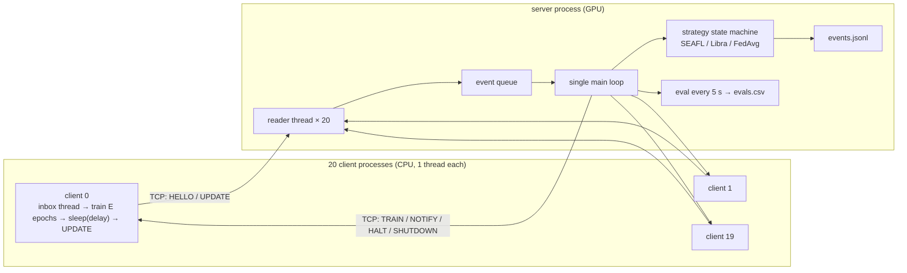

# REPORT_DATA.md: Data pack for the IEEE report

> For the team member writing the report. This file contains everything needed: the research question, the methods as implemented, the system design, the exact setup, deviations from the papers, all results (numbers included verbatim from the generated tables), figure captions, limitations and how to reproduce.
> Source of truth: the tables in `report/tables/` and the raw data in `report/data/e1/`. The reason behind every choice is in `../decisions.md` (D1–D20).
> Generated 2026-11-21 from experiment **E1** (FMNIST, 3 seeds). Experiments E2–E5 have not been run yet (§12).

---

## 0. What is in this pack

| Path | Contents |
|---|---|
| `report/figures/*.png, *.pdf` | All figures. Use the PDF in LaTeX (vector) and the PNG for slides. |
| `report/tables/*.md, *.csv` | All tables, generated by `plots.py` from the raw data only. |
| `report/tables/meta.json` | Target accuracy used (0.80), generation time, runs and seeds. |
| `report/data/e1/<algo>/<seed>/` | Raw per-run data: `config.json` (every parameter), `evals.csv` (one row every 5 s), `events.jsonl` (every aggregation, reject, halt and selection), `summary.json`. |

To regenerate every table and figure: `python plots.py report/data/e1 --target 0.80`, which writes them to `report/data/e1/figures/`.

---

## 1. Problem and research question

Semi-asynchronous federated learning (FL) has to cope with heterogeneous devices: slow clients produce **stale** updates, and fast clients contribute **unfairly often**. Two recent papers take opposite approaches:

- **SEAFL** (Islam et al., IPDPS 2025, arXiv:2503.05755) **weights** updates. It buffers K uploads, then weights each one by staleness and importance before mixing it into the global model.
- **Libra** (Wang et al., ICDCS 2024) **controls who contributes**. It limits fast devices, admits stale models according to how often a client has participated, and biases client selection.

**Research question:** under identical data, device heterogeneity and metrics, how do "weight the updates" (SEAFL) and "control who participates" (Libra) compare on accuracy, convergence time, communication and fairness? FedAvg (synchronous) is the reference.

Course framing (DS Option 1): two related distributed algorithms are implemented on one real message-passing distributed system and compared.

---

## 2. Algorithms as implemented

### 2.1 SEAFL (`flsim/strategies/seafl.py`)
- The server samples `n_active` clients and broadcasts w_0. It buffers uploads and aggregates once **K** are buffered.
- **Staleness bound:** the server does not aggregate while any client still training would end up with staleness > β. It waits for that client instead. (This turns out to matter a lot, see §8.)
- Staleness S_k = t − t_k (the current version minus the version the client trained from).
- Staleness factor **γ_k = α·β / (S_k + β)**.
- Importance **s_k = μ·(cos(Δ_k, w_t) + 1)/2**, with Δ_k = w_k − w_{t_k}, the update delta (deviation D7).
- Weight **p_k = (|D_k| / Σ|D|)·(γ_k + s_k)**, normalised over the buffer.
- **w_new = Σ p_k·w_k** and **w_{t+1} = (1 − ϑ)·w_t + ϑ·w_new**.
- The new model is sent only to the clients that just reported.
- SEAFL² (partial training, `--partial`) sends a `NOTIFY` to a client about to exceed β; that client uploads after its current epoch. It is implemented but **not used in E1**.

### 2.2 Libra (`flsim/strategies/libra.py`)
Rounds are triggered by a deadline: broadcast to the selected clients, collect uploads until deadline **T**, aggregate with sample-weighted averaging, and re-run selection every `select_every` rounds.
- **(a) Fast-device limit:** a client may upload several times per round. Uploads 1–2 are free. From upload 3 on, the server computes the **Sinkhorn distance** between the output distributions of the round's global model and the new local model on D_val (500 server-held samples). If the distance is ≥ **L**, the server sends `HALT`. There is a hard cap of σ_max = 5 uploads.
- **(b) Stale-model admission:** clients are sorted by participation count P. The top N·(1−M) get ϑ = 0 (their stale uploads are rejected) and the rest get ϑ = 1. Early drop ρ = 1 if (τ_max − v_i) < (P_i − P^M), or if v_i ≥ τ_max.
- **(c) Biased client selection:** candidates are the good-resource set A. They are sorted by their last reported loss (descending), and the top round(N·C) are picked.

### 2.3 FedAvg (`flsim/strategies/fedavg.py`)
Each round selects 12 clients at random, waits for all of them, and computes a sample-weighted average (McMahan et al., 2017).

---

## 3. System design: a real distributed system

| Aspect | Implementation |
|---|---|
| Processes | 1 server + **20 client processes**. They share no memory and communicate only by messages. |
| Transport | TCP via Python `multiprocessing.connection` (Listener/Client). An HMAC `authkey` handshake runs on every connection. Messages are pickled dicts. |
| Server concurrency | One reader thread per client feeds a single `queue.Queue`. **One main loop** is the only code that touches algorithm state, so no locks are needed. |
| Client concurrency | An inbox thread drains the socket continuously, so the server never blocks on a busy client (bug found and fixed, D15). |
| Algorithms | Each strategy is a pure state machine: `start / on_update / on_tick` return the messages to send. This makes them unit-testable without processes. |
| Clock | One clock only: the server's `time.monotonic()`. Clients never send timestamps, so there is no clock-skew issue. |
| Heterogeneity | Each client sleeps `base_delay × min(1 + Pareto(1.5), 20)` seconds per epoch, seeded per run. Real training happens as well. |
| Hardware | JarvisLabs L4 (28 vCPU, 124 GB RAM, 24 GB VRAM). Clients run on CPU with 1 thread each. The server runs on the GPU (evaluation, Sinkhorn). |
| Evaluation | The server evaluates the global model on the test set **every 5 s of wall time**, so all algorithms are sampled identically. |

**Message protocol**

| Direction | Type | Fields |
|---|---|---|
| C→S | `HELLO` | cid |
| C→S | `UPDATE` | cid, base_version, weights, n_samples, loss, epochs_done, upload_idx |
| S→C | `TRAIN` | version, weights, epochs, policy (Libra: multi_upload, sigma_max, theta) |
| S→C | `NOTIFY` | (SEAFL²) finish the current epoch and upload now |
| S→C | `HALT` | (Libra) stop training until the next TRAIN |
| S→C | `SHUTDOWN` | none |

**Architecture diagram** (Mermaid; render it or redraw it for the paper):


**Codebase:** about 4,000 lines of Python. **60 unit tests** cover the Dirichlet split, SEAFL weights (γ(0) = α, γ(β) = α/2, weights sum to 1), Libra admission, early drop, selection and Sinkhorn, transport round-trips including 20 simultaneous connections, the metrics and the plotting helpers. Every module has docstrings, and each strategy file starts with a paper → code map.

---

## 4. Experimental setup (E1)

| Setting | Value |
|---|---|
| Dataset | Fashion-MNIST, 60k train / 9.5k test (500 test samples held out as Libra's D_val) |
| Non-IID split | Dirichlet β = 0.5 over 20 clients (shards of 1,119–4,968 samples) |
| Model | Small CNN: conv 3×3 (16) → ReLU → maxpool → conv 3×3 (32) → ReLU → maxpool → FC 64 → FC 10. **105,866 params**, no BatchNorm, ~0.42 MB per model message |
| Local training | E = 5 epochs, batch 32, SGD lr 0.01 |
| Heterogeneity | base delay 3 s/epoch × min(1 + Pareto(1.5), 20). Measured real compute is 0.72 s/epoch |
| Budget | **1200 s wall time per run**, identical for all algorithms; evaluation every 5 s |
| Seeds | 0, 1, 2 (seed controls data split, device speeds, sampling, torch) |
| Target accuracy | **0.80** (≈ 90% of the best pilot accuracy) |

Full per-run hyperparameters (from `config.json`):

### Hyper-parameters

| run | algo | preset | n_clients | dataset | dirichlet_beta | epochs | batch_size | lr | base_delay | time_scale | budget_s | eval_every_s | K | stale_bound | alpha | mu | theta | n_active | partial | uniform_weights | C | tau_max | sigma_max | M | good_frac | resource_noise | deadline_s | sinkhorn_L | select_every | no_limit | random_select | staleness_select | clients_per_round | differs across seeds |
|---|---|---|---|---|---|---|---|---|---|---|---|---|---|---|---|---|---|---|---|---|---|---|---|---|---|---|---|---|---|---|---|---|---|---|
| fedavg | fedavg | scaled | 20 | fmnist | 0.5 | 5 | 32 | 0.01 | 3.0 | 1.0 | 1200.0 | 5 |  |  |  |  |  |  |  |  |  |  |  |  |  |  |  |  |  |  |  |  | 12 |  |
| libra | libra | scaled | 20 | fmnist | 0.5 | 5 | 32 | 0.01 | 3.0 | 1.0 | 1200.0 | 5 |  |  |  |  |  |  |  |  | 0.6 | 5 | 5 | 0.5 | 0.7 | 0.5 | 74.39999999999999 | 0.18 | 3 | False | False | False |  |  |
| seafl | seafl | scaled | 20 | fmnist | 0.5 | 5 | 32 | 0.01 | 3.0 | 1.0 | 1200.0 | 5 | 5 | 10.0 | 3.0 | 1.0 | 0.8 | 20 | False | False |  |  |  |  |  |  |  |  |  |  |  |  |  |  |

---

## 5. Deviations from the papers (put these in the report)

| # | Deviation | Why | Ref |
|---|---|---|---|
| 1 | 20 clients instead of 100 | 21 real processes on one machine. SEAFL K scaled to 5 (keeps K/N close to the paper's ratio) | D1, D6 |
| 2 | Real processes with injected Pareto delays instead of real phones or traces | Libra's traces are not public, and delays ≫ compute keep OS noise small | D1 |
| 3 | SEAFL importance uses the update delta Δ_k, not the full weights | The cosine of full weights is ≈ 1 for every update, which would make the term a no-op | D7 |
| 4 | SEAFL preset `scaled` (all 20 active, K = 5) | `paper`-style (N/2 active, K = 10) left 50% of clients out and reached only 0.771 | D17 |
| 5 | Libra deadline T = 4 × the fastest possible local round ≈ 74.4 s | Not given in the paper. With a median-based T no client reached upload 3, so mechanism (a) never ran | D17 |
| 6 | Libra re-selection every 3 rounds (paper: 10) | Only ~16 rounds fit in 1200 s | D17 |
| 7 | Libra Sinkhorn on the **mean softmax over D_val**, cost 1 − I, ε = 0.1, 100 iterations, **L = 0.18** | Not given in the paper. L = median distance from a calibration run | D6, D19 |
| 8 | Libra good-resource set = fastest 70%, re-drawn with lognormal(0, 0.5) noise at each refresh | Stand-in for ContextFL's time-varying signal. A fixed rank excluded 30% of clients forever | D13, D18 |
| 9 | Libra early drop ρ evaluated server-side, which then sends HALT | Clients do not know the current version | D13 |
| 10 | FedAsync / FedBuff not in E1 | Implemented as SEAFL flags, planned for E2 | D4 |

---

## 6. Calibration (pilot) runs, for the methodology section

The pilot ran 1 seed for 1200 s before E1.

| run | best acc | time to 95% of own best | Jain | never participated |
|---|---|---|---|---|
| fedavg | 0.805 | 380 s | 0.82 | 10% |
| libra (old T ≈ 33 s) | 0.885 | 355 s | 0.60 | 30% |
| seafl, paper-style preset | 0.771 | 920 s | 0.50 | 50% |
| seafl, scaled preset | 0.862 | 365 s | 0.82 | 0% |

- **Libra calibration:** with the median-based deadline, **0 Sinkhorn checks** happened, i.e. mechanism (a) never ran. After switching to T = 4 × the fastest round, there were 109 checks with distance quartiles p25 0.142 / **median 0.181** / p75 0.231, so L = 0.18.
- The pilot data is not in this pack. It is on the Jarvis box under `results/pilot*`.

---

## 7. E1 results (3 seeds, mean ± std)

### Accuracy summary

| run | seeds | best acc | final acc | fluctuation (std last 5 evals) |
|---|---|---|---|---|
| fedavg | 3 | 0.832 ± 0.021 | 0.830 ± 0.019 | 0.0000 ± 0.0000 |
| libra | 3 | 0.882 ± 0.002 | 0.880 ± 0.002 | 0.0014 ± 0.0009 |
| seafl | 3 | 0.870 ± 0.013 | 0.859 ± 0.015 | 0.0028 ± 0.0039 |

### Time to target accuracy 0.800 (reached seeds only)

| run | reached | time to target (s) | messages to target | MB to target |
|---|---|---|---|---|
| fedavg | 3/3 | 801.7 ± 280.6 | 116 ± 11 | 49.42 ± 4.82 |
| libra | 3/3 | 275.0 ± 35.4 | 174 ± 24 | 65.61 ± 9.53 |
| seafl | 3/3 | 261.7 ± 82.9 | 173 ± 9 | 73.85 ± 4.02 |

### Fairness (D20: influence vs inclusion)

| run | influence: variance | influence: Jain | influence: % never | inclusion: variance | inclusion: Jain | inclusion: % never |
|---|---|---|---|---|---|---|
| fedavg | 1.75 ± 0.57 | 0.897 ± 0.053 | 3.3 ± 4.7 | 1.75 ± 0.57 | 0.897 ± 0.053 | 3.3 ± 4.7 |
| libra | 239.66 ± 52.84 | 0.677 ± 0.052 | 10.0 ± 4.1 | 27.98 ± 7.47 | 0.768 ± 0.049 | 10.0 ± 4.1 |
| seafl | 68.25 ± 57.46 | 0.872 ± 0.038 | 0.0 ± 0.0 | 68.25 ± 57.46 | 0.872 ± 0.038 | 0.0 ± 0.0 |

- *Influence* counts every accepted upload. This is Libra's own P, and it measures how much a client shapes the model.
- *Inclusion* counts the aggregations a client contributed to, each at most once. This measures whether a client was heard at all.
- The two are identical for FedAvg and SEAFL (one upload per aggregation). They differ only for Libra, where clients upload several times per round (D20).

### Overhead normalised to fedavg

| run | n_up | n_down | n_ctrl | total_bytes | n_rejects | n_halts |
|---|---|---|---|---|---|---|
| fedavg | 1.00x | 1.00x | 0 (base 0) | 1.00x | 0 (base 0) | 0 (base 0) |
| libra | 4.51x | 2.03x | 56 (base 0) | 3.26x | 0 (base 0) | 56 (base 0) |
| seafl | 4.29x | 4.30x | 0 (base 0) | 4.30x | 0 (base 0) | 0 (base 0) |

### Libra mechanism counts per seed

| run | seed | halt:round_end | halt:sinkhorn | halt:stale_done | reject:theta | sinkhorn checks | median sinkhorn dist | selection refreshes |
|---|---|---|---|---|---|---|---|---|
| libra | 0 | 11 | 38 | 3 | 0 | 91 | 0.165 | 6 |
| libra | 1 | 17 | 32 | 0 | 0 | 81 | 0.157 | 6 |
| libra | 2 | 20 | 45 | 3 | 1 | 88 | 0.187 | 6 |

Per-seed raw numbers (use these for your own statistics):

### Raw per-seed results

| run | seed | best_acc | final_acc | time_to_target_s | n_up | n_down | n_ctrl | total_MB | n_rejects | n_halts | jain_influence | jain_inclusion | pct_never_influence | pct_never_inclusion | n_aggs | mean_staleness | halt_reasons |
|---|---|---|---|---|---|---|---|---|---|---|---|---|---|---|---|---|---|
| fedavg | 0 | 0.8049 | 0.8049 | 990.0 | 59 | 60 | 0 | 50.70 | 0 | 0 | 0.823 | 0.823 | 10.0 | 10.0 | 4 |  |  |
| fedavg | 1 | 0.8341 | 0.8341 | 1010.0 | 95 | 96 | 0 | 81.37 | 0 | 0 | 0.924 | 0.924 | 0.0 | 0.0 | 7 |  |  |
| fedavg | 2 | 0.8555 | 0.8502 | 405.0 | 142 | 144 | 0 | 121.85 | 0 | 0 | 0.945 | 0.945 | 0.0 | 0.0 | 11 |  |  |
| libra | 0 | 0.8838 | 0.8789 | 300.0 | 437 | 202 | 52 | 272.25 | 0 | 52 | 0.604 | 0.709 | 15.0 | 15.0 | 16 |  | sinkhorn:38 round_end:11 stale_done:3 |
| libra | 1 | 0.8833 | 0.8823 | 300.0 | 456 | 204 | 49 | 281.20 | 0 | 49 | 0.708 | 0.766 | 10.0 | 10.0 | 16 |  | sinkhorn:32 round_end:17 |
| libra | 2 | 0.8791 | 0.8791 | 225.0 | 443 | 203 | 68 | 275.24 | 1 | 68 | 0.718 | 0.828 | 5.0 | 5.0 | 16 |  | sinkhorn:45 round_end:20 stale_done:3 |
| seafl | 0 | 0.8628 | 0.8521 | 310.0 | 279 | 280 | 0 | 238.15 | 0 | 0 | 0.818 | 0.818 | 0.0 | 0.0 | 43 | 2.100 |  |
| seafl | 1 | 0.8589 | 0.8454 | 330.0 | 279 | 280 | 0 | 238.16 | 0 | 0 | 0.902 | 0.902 | 0.0 | 0.0 | 43 | 2.154 |  |
| seafl | 2 | 0.8881 | 0.8801 | 145.0 | 712 | 731 | 0 | 614.78 | 0 | 0 | 0.895 | 0.895 | 0.0 | 0.0 | 131 | 2.623 |  |

---

## 8. Key findings (with the numbers behind them)

1. **Accuracy: Libra ≥ SEAFL ≫ FedAvg.**
   - Final accuracy: Libra 0.880 ± 0.002, SEAFL 0.859 ± 0.015, FedAvg 0.830 ± 0.019.
   - Libra is also the most **consistent across seeds**: its std is about 7× smaller than SEAFL's.
2. **Speed: both semi-async methods reach 0.80 about 3× faster than FedAvg.**
   - Time to 0.80: SEAFL 262 ± 83 s, Libra 275 ± 35 s, FedAvg 802 ± 281 s.
   - SEAFL is marginally fastest on average but much less predictable.
3. **SEAFL's throughput is tied to the slowest client (the β staleness bound).**
   - Seeds 0 and 1 each contain one client at the 20× delay cap (≈ 304 s per local round). Both produce **exactly 43 aggregations**.
   - Seed 2's slowest client needs 103 s per round, and it produces **131 aggregations** and reaches 0.80 in 145 s.
   - Libra's fixed deadline isolates it from stragglers: 16 rounds and 437–456 uploads in every seed. *This is the clearest "weight vs gate" contrast in the data.*
4. **Fairness: the ranking flips.**
   - SEAFL includes every client (0% never, Jain 0.87).
   - Libra leaves out 10% and favours fast clients: influence Jain 0.68, inclusion Jain 0.77.
   - Libra's fast-device limit does act (115 Sinkhorn HALTs over 3 seeds), and it raised influence-Jain from 0.58 (no L, calibration run) to 0.68. It cannot fully fix fairness, because uploads 1–2 per round are always free.
5. **Communication:**
   - Both semi-async methods move far more data than FedAvg: SEAFL 4.3×, Libra 3.3×.
   - Libra is cheaper than SEAFL, because a repeat upload within a round needs no new download (downloads 2.0× FedAvg's vs SEAFL's 4.3×).
   - Libra adds about 56 HALT control messages per 3 seeds; SEAFL adds none.
6. **Libra's stale admission (mechanism b) barely ran at this heterogeneity level:** 6 stale uploads and 1 ϑ-reject over 3 seeds. With T ≈ 74 s few clients miss the deadline. We report this honestly rather than distorting the setup to force it. A heterogeneity sweep (E3) is where it would show.

---

## 9. Figures and suggested captions

| File | Suggested caption |
|---|---|
| `acc_vs_time.pdf` | Test accuracy vs wall-clock time on FMNIST (N = 20, Dirichlet 0.5). Lines show the mean over 3 seeds and shaded bands ±1 std. Both semi-asynchronous methods overtake FedAvg within ~100 s; Libra ends highest with the narrowest band. |
| `acc_vs_msgs.pdf` | Test accuracy vs cumulative messages (uploads + downloads + control). This shows the communication cost of each method's accuracy. |
| `time_to_target.pdf` | Wall-clock time to reach 0.80 test accuracy (mean ± std over 3 seeds). |
| `participation_hist.pdf` | Distribution of per-client *influence* (accepted uploads). Libra's long tail shows fast clients uploading several times per round. |
| `inclusion_hist.pdf` | Distribution of per-client *inclusion* (aggregations joined, each at most once). SEAFL spreads participation widely; Libra has a cluster of never-included clients (bar at 0). |
| `staleness.pdf` | Staleness of updates aggregated by SEAFL. Bounded by β = 10, mean ≈ 2.1–2.6. |

The architecture diagram is the Mermaid block in §3; redraw it for the paper.

---

## 10. Limitations / threats to validity
- 20 clients, one dataset (FMNIST) and one non-IID level so far. Results are at a smaller scale than the papers.
- Device heterogeneity is synthetic (seeded Pareto delays), not real device traces.
- Several Libra quantities are not specified in the paper: T, L, the Sinkhorn cost, the good-resource signal and the selection period. Our choices (§5) affect Libra's behaviour. L and T come from calibration runs on seed 0, which was also used in E1.
- 3 seeds. Seed-to-seed variance is large for SEAFL because of the slowest-client coupling (finding 3).
- Real wall-clock timing on a shared cloud VM. Run-to-run jitter exists but is small relative to the injected delays.

---

## 11. How to reproduce
```bash
git clone https://github.com/rgabhi2526/dist_project.git && cd dist_project
python3 -m venv .venv && .venv/bin/pip install torch torchvision numpy matplotlib pytest ruff
.venv/bin/python -m pytest -q                                   # 60 tests
PY=.venv/bin/python EXTRA="--epoch-compute-s 0.72" bash experiments.sh e1   # ~3.2 h, resumable
.venv/bin/python plots.py results/e1 --target 0.80
```
Measure `--epoch-compute-s` on the target machine first; `progress.md` §4 has the snippet.

---

## 12. Not done yet (planned, P1)
- **E2:** CIFAR-10 plus the FedBuff and FedAsync baselines.
- **E3:** heterogeneity sweep (this is where Libra's stale admission would act).
- **E4:** sensitivity of SEAFL K and β, and Libra τ_max, σ_max and M.
- **E5:** ablations (SEAFL vs SEAFL², β = ∞; Libra-NoL, -RS, -SS).

If the report needs any of these, say so and they can be run.
